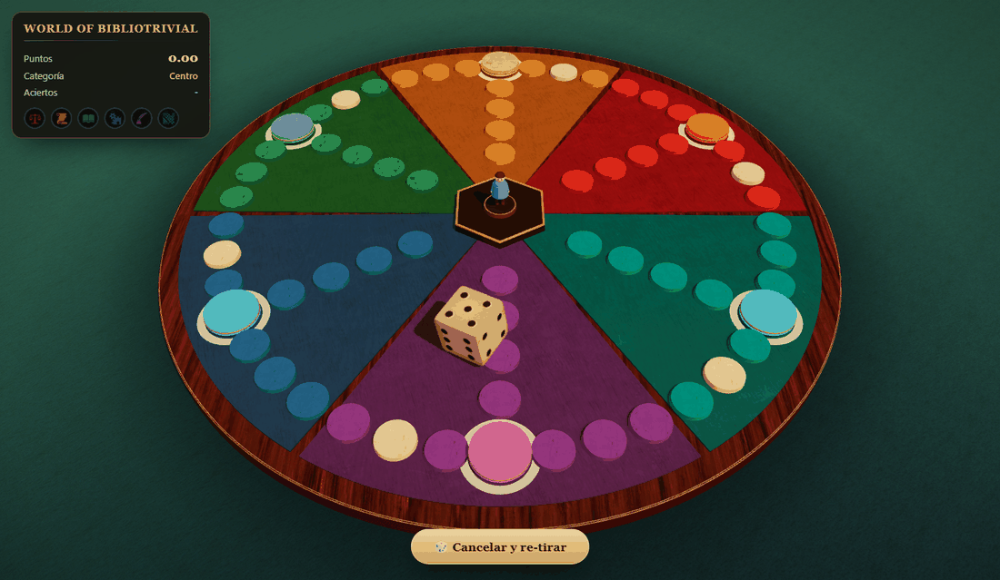

# World of BiblioTrivial

Juego de tablero 3D en el navegador inspirado en el Trivial, con preguntas de la oposición de **Auxiliares de Bibliotecas (Ministerio de Cultura / Castilla y León)**.



## Características

- **Tablero en rueda de seis sectores**, como un Trivial de verdad: seis cuñas de color, seis radios de casillas hacia el centro, seis sedes de categoría con su icono y un centro hexagonal.
- **Mesa con materiales reales**: paño de fieltro verde y marco de madera con texturas CC0, luces cálidas, sombras y viñeta.
- **Ficha con peana**: el monigote va sobre un pedestal cilíndrico con seis huecos donde se van encajando las cuñas de quesito que ganas.
- **Dado 3D** que rueda sobre el tablero y cae mostrando arriba el número que has sacado.
- **Carta física**: la pregunta llega como una carta girada que se voltea sobre la mesa.
- **Seis categorías** que agrupan los nueve temas del temario: Legislación, Procesos y documentación, Servicios y tipología, Gestión, Bibliografía e historia, Nuevas tecnologías.
- **Personaje personalizable** (raza: humano/elfo/enano/orco, color).
- Dificultades: Normal (C1/C2) y Difícil (A1/A2).
- Persistencia local (IndexedDB): mejores tiempos y logros.
- Carga/actualización de contenido desde `content/`.

## Reglas

Las del Trivial de mesa:

1. Tiras el dado y avanzas **exactamente** las casillas que salgan, eligiendo entre las alcanzables.
2. Caer en una casilla normal pregunta por la categoría de esa casilla. Acierto **+1**, fallo **−1/3**.
3. Caer en una **sede** (la casilla grande con icono) y acertar te da **su cuña**, si aún no la tienes.
4. Caer en el **centro** te deja **elegir categoría**, mientras te falten cuñas.
5. Las casillas **"tira otra vez"** dan una tirada extra sin pregunta.
6. Con las **seis cuñas**, caer en el centro plantea la **pregunta final**, de una categoría al azar (en el juego de mesa la eligen los rivales). Si aciertas, ganas; si fallas, tendrás que salir del centro y volver a entrar.

### Ayudas de desarrollo

- `?debug=quesitos` arranca la partida con las seis cuñas del quesito ya puestas, para revisar la ficha.
- `?tier=low|medium|high` fuerza el nivel de calidad, y `?dpr=1.5` el factor de resolución. Sirve para probar cómo se verá en un móvil desde el escritorio.
- `?debug=fit` escribe en consola la distancia de cámara y la extensión del tablero en pantalla.

## Rendimiento

La escena es casi todo relleno de píxeles, así que lo que más manda es cuántos píxeles se dibujan. Hay tres niveles que se eligen solos según el dispositivo:

| | Resolución máxima | Sombras | Sheen del paño | Física |
|---|---|---|---|---|
| high | ×2 | 2048, suaves | sí | 6 subpasos |
| medium | ×1,5 | 1024 | sí | 4 subpasos |
| low | ×1,15 | 512, sin sombra de casillas | no | 3 subpasos |

Ningún nivel quita texturas, físicas ni ninguna mecánica: solo baja la resolución de dibujo y el detalle de la iluminación. Además, en caliente, si el dispositivo no llega a 45 fps se reduce la resolución sola (hasta ×0,65) y si va sobrado vuelve a subir.

En vertical la cámara se coloca más cenital y el encuadre pasa a limitarse por el ancho: el tablero ocupa el 84 % del lado corto tanto en apaisado como en vertical.

## Desarrollo

```bash
npm install
npm run dev
```

Abre http://localhost:5173

## Contenido de oposiciones

Las preguntas se extraen de los PDF **en local** y se publican como JSON. El
navegador nunca parsea un PDF, así que el despliegue solo lleva
`content/manifest.json` y `content/questions/*.json`.

```bash
npm run ingest -- --exam content/oposiciones/normal/2024/examen1.pdf \
                   --answers content/oposiciones/normal/2024/respuestas1.pdf \
                   --id examen1-2022 --year 2022 --register
```

Detalle del formato, de la revisión de clasificaciones dudosas y de las opciones en
[content/README.md](content/README.md).

## Build

```bash
npm run build
npm run preview
```

## Créditos

Texturas de [Poly Haven](https://polyhaven.com) (CC0) e iconos de [game-icons.net](https://game-icons.net) (CC BY 3.0, autor Lorc). Detalle en [CREDITOS.md](CREDITOS.md).

*Trivial Pursuit* es una marca de Hasbro; este proyecto es un juego propio inspirado en su mecánica.
